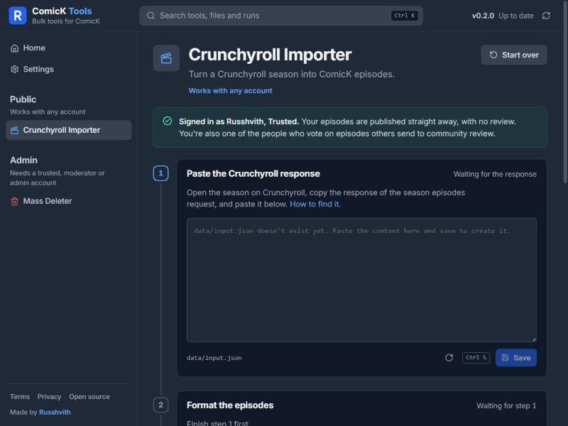
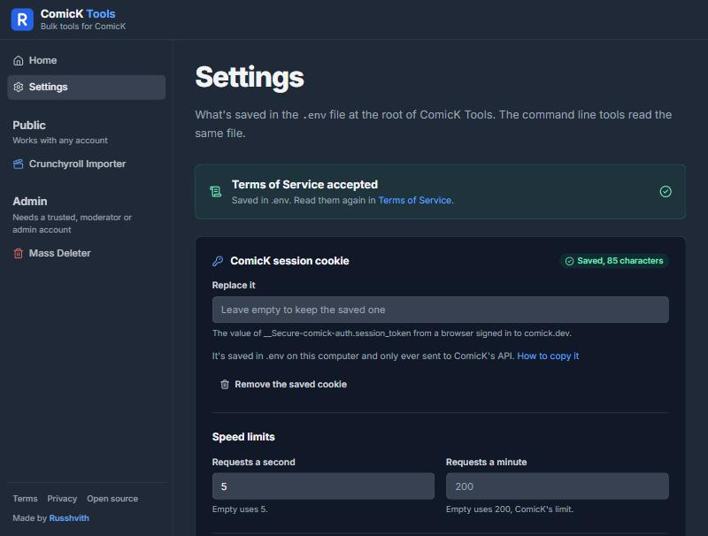
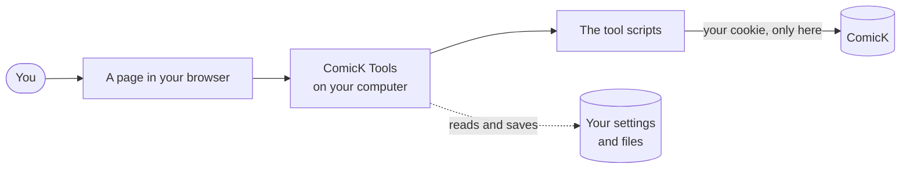
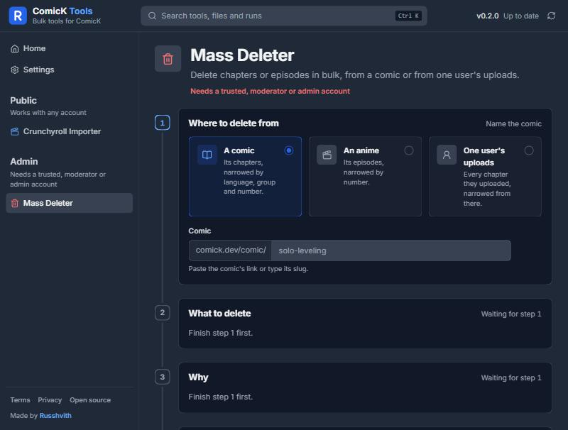
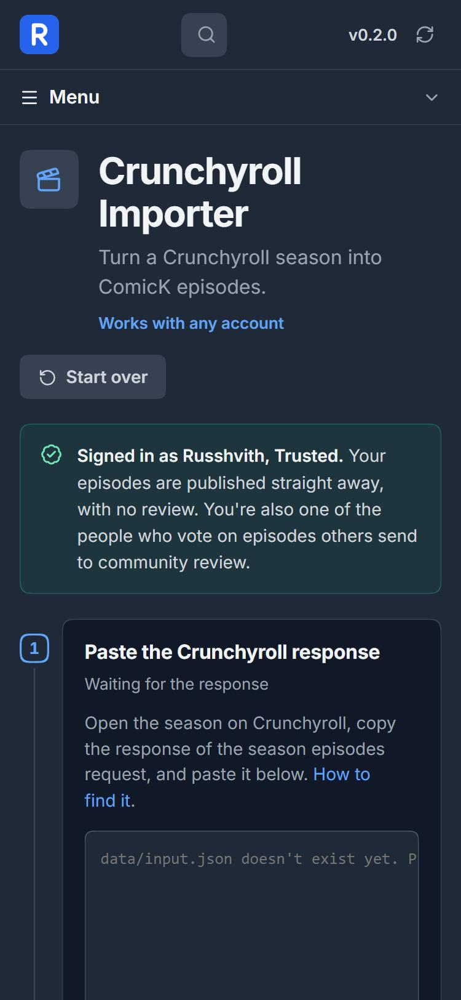

<div align="center">

# ComicK Tools

**Bulk tools for ComicK, run from your own computer.**

Upload a whole anime season in minutes, tidy up chapters in bulk, and do it all from a simple page in your browser.

[](CHANGELOG.md)
[](LICENSE)
[](https://www.python.org/downloads/)
[](https://nodejs.org/en/download)
[](run/README.md)



</div>

## What is this?

[ComicK](https://comick.dev) lets people add chapters and anime episodes one at a time through its website. That's fine for one or two, and slow for a whole season.

ComicK Tools does the repetitive part for you. You give it the information once, check it over, and it sends everything to ComicK using **your own account**, just as if you had filled in the website's forms yourself.

- **It runs on your computer.** Nothing is uploaded to us, and there's no account to make.
- **It works in your browser.** You open a page, follow numbered steps, and watch the progress live.
- **You stay in control.** Every step can be checked before anything is sent, and destructive actions always ask first.

## The tools

| Tool | Who can use it | What it does |
| --- | --- | --- |
| [**Crunchyroll Importer**](tools/public/crunchyroll-importer/README.md) | Anyone with a ComicK account | Turns a season from Crunchyroll into ComicK episodes, with titles, dates, durations and preview images. |
| [**Mass Deleter**](tools/admin/mass-deleter/README.md) | Trusted users, moderators and admins | Removes many chapters or episodes at once, from a comic or from one user's uploads. |

More tools can be added over time. Each one lives in its own folder, see [Contributing](docs/contributing.md).

## Get started

You need two free programs, then a double click.

### 1. Download ComicK Tools

Click the green **Code** button at the top of this page and pick **Download ZIP**, then unzip it somewhere easy to find, like your Documents folder.

If you already use git:

```bash
git clone https://github.com/Russhvith/comick-tools.git
```

### 2. Install Python and Node.js

| Program | Version | Where to get it |
| --- | --- | --- |
| Python | 3.8 or newer | [python.org/downloads](https://www.python.org/downloads/) |
| Node.js | 20.9 or newer (the "LTS" one) | [nodejs.org/en/download](https://nodejs.org/en/download) |

> [!TIP]
> On Windows, tick **Add python.exe to PATH** on the first screen of the Python installer. It saves a lot of trouble later.

### 3. Start it

Open the `run` folder and double click the starter for your computer:

| Your computer | Double click |
| --- | --- |
| Windows 11 | `run\windows\start.bat` |
| Windows 10 | `run\windows\win10\start.bat` |
| Windows 7 | `run\windows\win7\start.bat` (command line menu, the web page needs Windows 10 or newer) |
| Mac | `run/macos/start.command` |
| Linux | `run/linux/start.sh` |

It checks that everything is installed, tells you exactly what to download if something is missing, and then starts. The first start takes a minute while it sets itself up. When you see an address like `http://localhost:4321`, open it in your browser.

### 4. Connect your ComicK account

The first time, the page asks you to accept the [Terms of Service](legal/terms.txt), then to paste your ComicK **session cookie** under **Settings**. The cookie is how the tools act as you. The [auth guide](docs/auth.md) shows how to copy it in about a minute.

<p align="center"></p>

That's it. Pick a tool from the menu on the left and follow its steps.

## How it works



1. **You** fill in a few fields on the page.
2. **The page** hands them to a small server that runs only on your computer.
3. **The server** starts the tool, which talks to ComicK with your cookie.
4. **You watch** the tool's progress live, and can answer its questions or stop it.

Your cookie stays in a file on your computer called `.env`, and is only ever sent to ComicK. More detail, in plain words, in [How it works](docs/architecture.md).

## A look around

<table>
  <tr>
    <td width="60%"></td>
    <td width="40%"></td>
  </tr>
  <tr>
    <td>The Mass Deleter walks you through what to delete, and why, before anything happens.</td>
    <td>It works on phones and tablets too, and scales up on large screens.</td>
  </tr>
</table>

## Using the command line instead

Every tool also runs without the web page, which is handy for scripts or older computers. Each tool's README lists its commands. For example:

```bash
python tools/public/crunchyroll-importer/format_episodes.py
python tools/public/crunchyroll-importer/upload_episodes.py --slug your-anime-slug
```

Anything you leave out, the tool asks for. Every question has a matching option, so nothing ever has to be typed by hand.

## Safety and privacy

- **Your cookie never leaves your computer**, except to ComicK itself.
- **The page only opens on your own computer** unless you switch on network mode in Settings, which lets other devices on your Wi-Fi use it. It has no password, so only turn it on at home.
- **Nothing runs until you accept the Terms**, and nothing connects to ComicK before that.
- **Deleting always asks first**, and the Mass Deleter needs `DELETE` typed to go ahead.

The full details are in the [Privacy Policy](legal/privacy.txt) and [Terms of Service](legal/terms.txt).

## Documentation

| Guide | What's in it |
| --- | --- |
| [**Wiki**](https://github.com/Russhvith/comick-tools/wiki) | Step by step guides for every tool, settings and troubleshooting, for everyone. |
| [Starting it](run/README.md) | The launchers for each system, and what they check. |
| [Setup](docs/setup.md) | Installing by hand, and every setting in `.env`. |
| [Auth](docs/auth.md) | Copying your ComicK session cookie. |
| [How it works](docs/architecture.md) | How the pieces fit together, with diagrams. |
| [Design](docs/design.md) | How the page looks and why. |
| [Web UI](ui/README.md) | The browser page in detail, for developers. |
| [Contributing](docs/contributing.md) | Reporting bugs, suggesting ideas, and changing the code. |
| [Changelog](CHANGELOG.md) | What changed in each version. |

## Getting help

- **Something broken or confusing?** [Open an issue](https://github.com/Russhvith/comick-tools/issues/new/choose) and pick a form.
- **Questions?** See [Support](SUPPORT.md) for Discord and email.
- **Found a security problem?** Please report it privately, see [Security](SECURITY.md).

Everyone taking part is expected to follow the [Code of Conduct](CODE_OF_CONDUCT.md).

## Project layout

```
comick-tools/
├── run/                 starters for Windows, macOS and Linux
├── tools/
│   ├── public/          tools any account can use
│   └── admin/           tools for trusted users and above
├── lib/comick_tools/    code the tools share (console, .env, ComicK API)
├── ui/                  the browser page and its local server
├── docs/                guides and images
├── legal/               terms, privacy policy, open-source package list
├── .env.example         every setting, empty, with a note
└── VERSION              the current version
```

## License

Copyright (C) 2026 Russhvith

ComicK Tools is free software under the [GNU General Public License v3.0](LICENSE). Anyone can use, change and share it, and anyone who shares a changed version has to share its source under the same license. It comes with no warranty.
