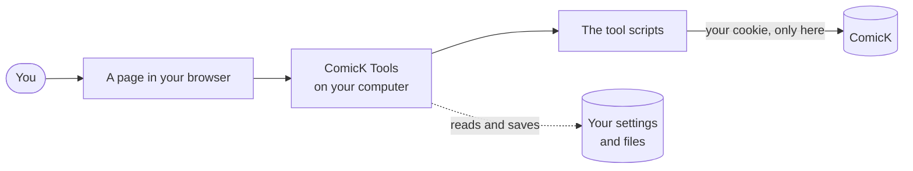
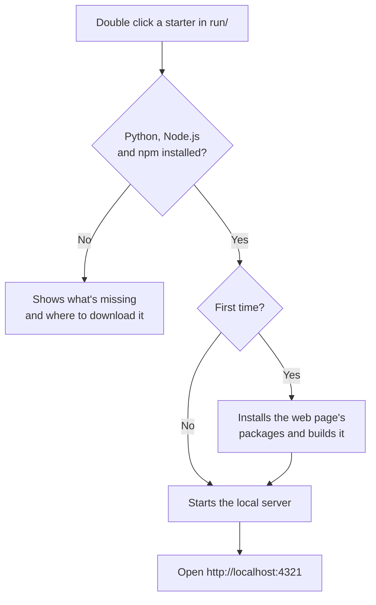
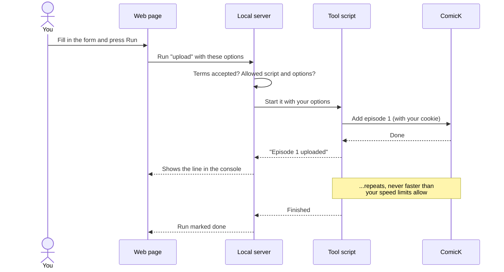
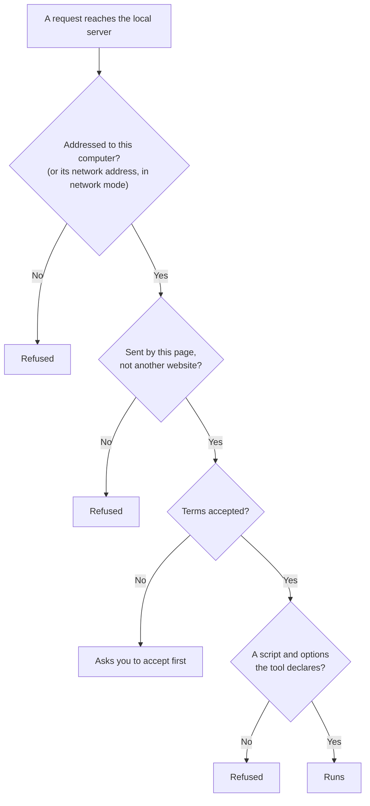
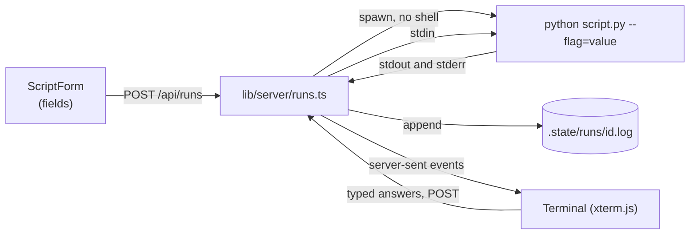

# How it works

This guide explains how ComicK Tools fits together. The first half is for everyone, no programming needed. The second half goes into the details for people changing the code.

- [The short version](#the-short-version)
- [The pieces](#the-pieces)
- [What happens when you press Run](#what-happens-when-you-press-run)
- [What's saved, and where](#whats-saved-and-where)
- [How it keeps you safe](#how-it-keeps-you-safe)
- [For developers](#for-developers)

## The short version

ComicK Tools is like a helper sitting at your computer. You tell it what to do on a web page, it does the repetitive clicking on ComicK for you, using your account, and shows you what it's doing as it goes.

Everything happens on your own computer. There's no ComicK Tools website or server somewhere else, and nothing is sent to us.



## The pieces

| Piece | What it is, in plain words |
| --- | --- |
| **The tools** | Small programs (written in Python) that each do one job, like importing a season or deleting chapters. They can run on their own from a terminal. |
| **The web page** | A friendlier way to use the tools. It shows forms, steps and a live console instead of a black terminal window. |
| **The local server** | The part of the web page that runs on your computer. It starts the tools, saves your settings and remembers past runs. |
| **The starters** | The files in `run/` you double click. They check everything is installed and start the local server. |
| **The `.env` file** | A small text file holding your settings: your ComicK cookie, speed limits and so on. It never leaves your computer. |
| **ComicK** | The website you're adding to. The tools talk to its API, the same one the website uses. |

### Starting up



On Windows 7 the web page can't run (Node.js no longer installs there), so the Windows 7 starter opens a numbered menu of the tools in the same window instead.

## What happens when you press Run

Say you're uploading a season with the Crunchyroll Importer and press **Run**.



A few things worth knowing:

- **The console is live.** The page shows the tool's output the moment it's printed. If the tool asks a question, you type the answer right there.
- **You can close the page.** The run carries on. Open the page again and the console replays everything you missed.
- **Speed limits are always respected.** ComicK allows only so many requests a minute, and the tools stay under that, waiting when they need to.
- **Stopping is safe.** The Stop button ends the tool. Whatever was already sent stays sent, and nothing more goes out.

## What's saved, and where

Everything stays inside the ComicK Tools folder on your computer.

| What | Where | What's in it |
| --- | --- | --- |
| Settings | `.env` | Your ComicK cookie, speed limits, whether you've accepted the Terms, network mode. |
| Tool files | each tool's `data/` folder | What you paste in, what the tool writes out, downloaded preview images. **Start over** clears these. |
| Run history | `.state/runs/` | The last 100 runs and their console output. |
| The built web page | `ui/.next/` | Made by the starter, rebuilt after updates. |

Deleting the ComicK Tools folder removes all of it. The [Privacy Policy](../legal/privacy.txt) lists every place the tools connect to.

## How it keeps you safe



- **Only your computer can use it.** The server refuses requests that aren't addressed to your own computer, so a website you visit can't quietly use it. Network mode is the one exception, and only when you turn it on.
- **Your cookie is never shown.** The page can tell whether a cookie is saved and how long it is, never its value. It's only sent to ComicK.
- **Tools can only do what they declare.** Each tool lists its scripts, options and files in a `tool.json`. Nothing else can be run or opened through the page.
- **Nothing reaches ComicK until you accept the Terms.** That includes the check of which account you're signed in as.
- **Deleting asks first.** The Mass Deleter lists everything it's about to delete and needs `DELETE` typed to go ahead.

## For developers

### Repository layout

```
comick-tools/
├── run/                   launchers per OS (check dependencies, start the UI)
├── tools/
│   ├── public/<tool>/     any account: scripts, tool.json, README, data/
│   └── admin/<tool>/      trusted and above
├── lib/comick_tools/      shared Python: console, env, api, terms, whoami
├── ui/                    Next.js app and its local server
│   ├── app/               routes: pages and /api
│   ├── features/          app logic by feature (home, steps, runs, settings, ...)
│   ├── components/        shared UI, atomic design (atoms to templates)
│   ├── lib/server/        server only code (env, guard, runs, repo, update, ...)
│   ├── proxy.ts           Host and Origin check in front of every page
│   └── scripts/serve.mjs  production supervisor (restarts on update)
├── docs/                  guides
└── legal/                 terms, privacy policy, package list
```

### The Python side

- Every tool is a plain script run with `python path/to/script.py`. Scripts put `lib/` on `sys.path` themselves, so there's nothing to install.
- `comick_tools.env` reads `.env` relative to the repo (not the working directory), and `set_env_values` writes it while keeping comments and order.
- `comick_tools.api` is the ComicK client. It sends the cookie, spaces requests to `COMICK_UPLOADS_PER_SECOND`, keeps a rolling minute under `COMICK_REQUESTS_PER_MINUTE`, honours `x-ratelimit-*` headers and retries a 429 once.
- `comick_tools.terms.require_terms` runs right after each tool's header and stops it until the Terms are accepted (`[Y/n]` in a terminal, `--accept-terms` otherwise).
- `comick_tools.console` handles colour, live progress lines and the plain ASCII fallback on Windows 7 and 8.
- Everything targets Python 3.8, standard library only.

### The web UI

| Route | Does |
| --- | --- |
| `/` | Homepage: account, tools, git activity, changelog |
| `/tools/<group>/<tool>` | A tool: steps or forms, console, recent runs |
| `/settings` | `.env` editor (cookie, limits, network mode, API address) |
| `/legal/<doc>` | Terms, privacy policy, package list |
| `/api/tools` | Tools read from every `tool.json` |
| `/api/runs`, `/api/runs/<id>`, `/api/runs/<id>/stream` | Start, stop, answer and stream runs (server-sent events) |
| `/api/files`, `/api/images`, `/api/reset` | Read and save declared tool files, serve previews, Start over |
| `/api/account` | Who the cookie belongs to, through `lib/comick_tools/whoami.py` |
| `/api/settings`, `/api/terms`, `/api/restart` | Settings, accepting the Terms, restarting for network mode |
| `/api/version`, `/api/update` | Update check and in-app update |

- **Running a script**: `lib/server/runs.ts` spawns `python -u script.py --flag=value ...` with no shell. Arguments come only from fields the `tool.json` declares. Output is kept in memory while live and appended to `.state/runs/<id>.log`, and `/stream` replays it then follows along.
- **The account check** goes through Python because Cloudflare turns away Node's own requests. The answer is cached for five minutes per cookie, and calls arriving together share one process.
- **The homepage's git data** costs one `git show-ref` per visit while nothing has changed, and is rebuilt when a ref moves or the day changes.
- **Updates**: `/api/update` pulls, runs `npm ci` if the lockfile changed, builds, then exits with code 75. `scripts/serve.mjs` sees that code and starts the server again. `/api/restart` uses the same code for network mode.
- **Guarding** happens in two layers. `scripts/server.mjs` runs Next inside its own HTTP server, for `npm start` and `npm run dev` alike, so `scripts/gate.mjs` sees every request and WebSocket upgrade first, including Next's own dev endpoints. It refuses connections from other devices unless network mode is on (by the socket's address, which can't be faked), any `Host` that isn't this machine, and cross-site requests to `/api`, `/_next` and `/__nextjs`. Then `lib/server/guard.ts`, called by every API route and by `proxy.ts` for every page, allows `localhost`, `127.0.0.1` and `::1`, plus this machine's own hostname and interface addresses when network mode is on. Writes also need a matching `Origin`. Pages send `X-Frame-Options: DENY` so no other site can frame them.

### Data flow of one run



### Where to start reading

- Adding a tool: [contributing.md](contributing.md#adding-a-new-tool), then an existing `tool.json`.
- The UI in depth: [ui/README.md](../ui/README.md).
- Look and feel: [design.md](design.md).
