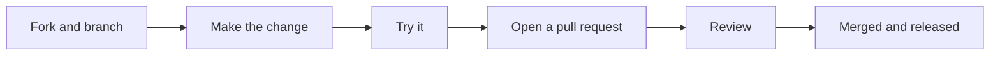

# Contributing

Thanks for wanting to help. You don't need to write code to make a difference: a clear bug report or a well explained idea is just as useful.

- [Ways to help](#ways-to-help)
- [Reporting a bug or suggesting an idea](#reporting-a-bug-or-suggesting-an-idea)
- [Setting up to change the code](#setting-up-to-change-the-code)
- [How a change gets in](#how-a-change-gets-in)
- [House style](#house-style)
- [Adding a new tool](#adding-a-new-tool)
- [Settings, privacy and the legal pages](#settings-privacy-and-the-legal-pages)
- [Releasing a version](#releasing-a-version)

## Ways to help

| You'd like to... | Do this |
| --- | --- |
| Tell us something is broken | Open a [bug report](https://github.com/Russhvith/comick-tools/issues/new?template=01-bug-report.yml). |
| Suggest something new | Open a [new feature request](https://github.com/Russhvith/comick-tools/issues/new?template=02-new-feature.yml). |
| Suggest a change to something that exists | Open an [improvement request](https://github.com/Russhvith/comick-tools/issues/new?template=03-improvement.yml). |
| Fix or build something yourself | Read on, then open a pull request. |
| Ask a question | See [Support](../SUPPORT.md). |
| Report a security problem | Please don't open an issue, see [Security](../SECURITY.md). |

Everyone taking part follows the [Code of Conduct](../CODE_OF_CONDUCT.md).

## Reporting a bug or suggesting an idea

The issue forms ask for what's needed, but a few things make a report much easier to act on:

- **Which tool, and how you ran it**: the web page or the command line.
- **Your system**: Windows 11, 10 or 7, macOS or Linux. The version is at the top right of the web page.
- **What you expected, and what happened instead.**
- **The steps to make it happen again**, as if explaining to someone who's never used it.
- **A screenshot or the console output.**

> [!WARNING]
> Before sharing a screenshot or log, check it doesn't show your session cookie or the contents of your `.env` file. Anyone with your cookie can act as you on ComicK.

## Setting up to change the code

You need the same things as for running it: Python 3.8 or newer, Node.js 20.9 or newer, and git.

```bash
git clone https://github.com/Russhvith/comick-tools.git
cd comick-tools
cp .env.example .env
```

Then, for the web page, run it in development mode, which reloads as you edit:

```bash
cd ui
npm install
npm run dev
```

It opens on http://localhost:4321. The Python tools run straight from their folders with `python path/to/script.py`, no install step. [Setup](setup.md) has the details and [How it works](architecture.md) explains where everything lives.

## How a change gets in



1. **Fork** the repo and make a branch with a short name, like `fix-upload-retry`.
2. **Keep it focused.** One fix or feature per pull request is far easier to review than several.
3. **Try it** the way a user would, in the web page and from the command line.
4. **Open a pull request.** The template asks what changed, why, and how you checked it.
5. **Review.** Expect questions, they're about the code, not about you.

### Before you open it

- [ ] Every tool still runs from the command line, not just the web page.
- [ ] Python changes still run on Python 3.8. Check with `pip install vermin` and `vermin -t=3.8- --violations <file>`.
- [ ] The web page still type checks: `cd ui && npm run typecheck`.
- [ ] UI changes look right on a phone and a large screen.
- [ ] New settings are in `.env.example`, on the Settings page, and in the docs.
- [ ] Anything new sent over the network or saved to disk is in the [Privacy Policy](../legal/privacy.txt).
- [ ] Screenshots and logs have no cookie in them.

## House style

### Code

- **Readable beats clever.** Someone new should be able to follow it.
- **Comments say why, not what.** If the code already says it, skip the comment.
- **Match what's around you.** Same naming, same structure, same tone in messages.
- **Python stays on 3.8.** Windows 7 can't install anything newer, and the tools keep working there. That rules out things like `match`, `str.removeprefix` and `list[str]` style hints at runtime.
- **Consoles on Windows 7 and 8 have no colour.** The shared `console` module already falls back to plain text, so use it rather than printing colour codes yourself.
- **The web page follows comick.dev's look.** See [Design](design.md).

Good:

```python
# ComicK rate limits at roughly 60 req/min, so stay under it with headroom.
time.sleep(1.2)
```

Less useful:

```python
# Wait 1.2 seconds.
time.sleep(1.2)
```

### Commit messages

- A short first line that says what the commit does: `Add dry run flag to mass deleter`.
- If it needs explaining, a blank line and then why.

### License header

Every source file (`.py`, `.ts`, `.tsx`, `.js`, `.mjs`, `.css`) starts with these two lines in that language's comment style, then a blank line:

```python
# SPDX-License-Identifier: GPL-3.0-only
# Copyright (C) 2026 Russhvith
```

`//` for TypeScript and JavaScript, `/* ... */` for CSS. It goes above `"use client"` and above a module docstring. JSON, Markdown, SVG and the generated `ui/next-env.d.ts` don't get one.

## Adding a new tool

A tool is a folder with a script, a short description for the web page, and a README.

1. **Make a folder** with a kebab-case name, under `tools/public/` if any account can use it, or `tools/admin/` if it needs trusted rights or above. For example `tools/public/chapter-fixer/`.
2. **Add a `README.md`** (copy the layout from an existing tool) and a `requirements.txt`.
3. **Add a `data/` folder** with an empty `.gitkeep`. Input and output files go there and stay out of git.
4. **Use the shared code** in `lib/comick_tools` for settings and ComicK (`env.comick_settings()`, `api.connect()`). It already handles the cookie and the rate limits.
5. **Ask for the Terms first.** Add `--accept-terms` to the script's options and call `require_terms(args.accept_terms)` from `comick_tools.terms` right after `out.header(...)`.
6. **Give every question an option.** Whatever the script asks for, there should be a flag that answers it, and passing the flag should skip the question. The web page relies on this: filled in fields become flags, empty ones are left for the script to ask.
7. **Add a `tool.json`** so the web page lists it. Copy one from an existing tool. Its `name` is in Title Case, like "Crunchyroll Importer". Each script declares its options as `bool`, `text` or `select` fields, and the page builds the form from them. Only declared scripts and options can run from the page, and only listed `files` can be edited.
8. **Mention it** in the tools table of the root `README.md`, and add any new setting to `.env.example`.

Mark scripts that talk to ComicK with `"needsCookie": true`, so the page warns when no cookie is saved.

A tool that runs in order can add `steps`, and the page shows them as a numbered flow instead of tabs:

```json
"steps": [
  { "id": "input", "title": "Paste the response", "file": "data/input.json", "view": "crunchyroll-input" },
  { "id": "format", "title": "Format", "script": "format", "needs": "input", "produces": "review" },
  { "id": "review", "title": "Check the types", "file": "data/output.txt", "view": "episode-list" }
]
```

- A step is either a `file` shown through a `view`, or a `script`. Views live in `ui/features/steps/views/` and are listed in its `index.ts`.
- `needs` locks a script until that step is ready.
- `produces` names the file step a script writes. The page marks the script up to date when that output is newer than its input, and asks before replacing hand edits.

## Settings, privacy and the legal pages

- **A new setting** goes in four places: `.env.example` (empty, with a short note), the Settings page, [Setup](setup.md), and the Privacy Policy if it changes what's stored or where things are sent.
- **The legal pages** are `legal/terms.txt` and `legal/privacy.txt`, shown in the web page under Legal. Keep them plain text, lines no longer than 76 characters, in the same shape: a title, release and effective dates, then numbered sections. When the meaning changes, update the dates too.
- **Every claim in the Privacy Policy has to match the code.** A new connection or a new kind of saved data means updating it in the same pull request.
- **New dependencies** go in the open-source list: run `python legal/packages.py --write`.

## Releasing a version

The web page compares the `VERSION` file with the newest GitHub release and offers an update when the release is newer.

1. Add the version to [CHANGELOG.md](../CHANGELOG.md), bump `VERSION` (`0.2.0` to `0.3.0`, say), run `python legal/packages.py --write`, and commit.
2. Tag the commit and push both:

   ```bash
   git tag v0.3.0
   git push origin main --tags
   ```

3. Publish a GitHub release for the tag, with the changelog entry as its notes:

   ```bash
   gh release create v0.3.0 --title "v0.3.0" --notes-file notes.md
   ```

Drafts and prereleases don't count as the newest release, so they don't trigger the update prompt.
