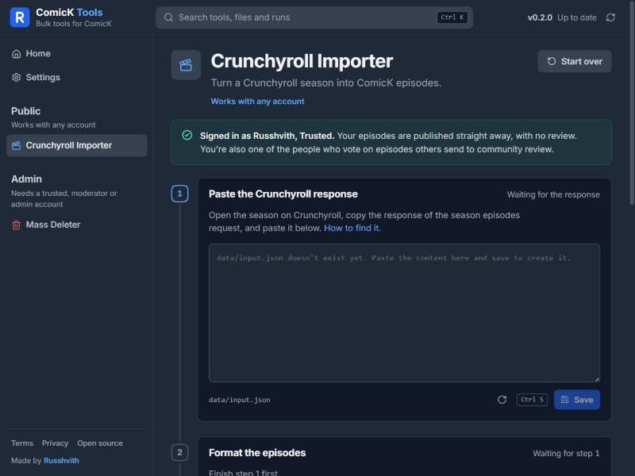
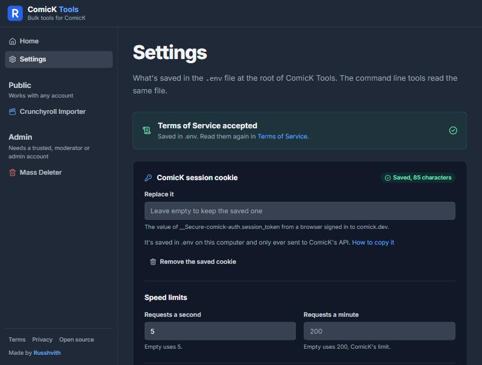
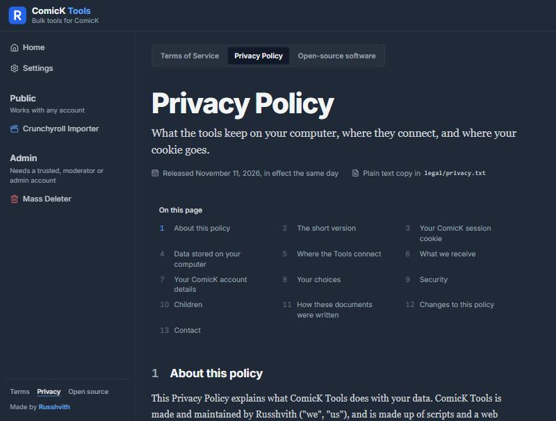
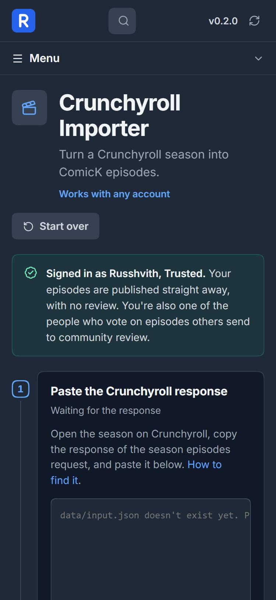

# Design

How the ComicK Tools page looks and behaves, and why. The first part is the thinking behind it. The second part is the reference: colours, type, layout and components.

## The idea

**It should feel like part of ComicK.** People using these tools already know comick.dev, so the page borrows its dark colours, its font and its icons. Nothing new to learn.

Four principles guide every screen:

1. **One thing at a time.** Long jobs are broken into numbered steps. A step that can't be done yet says what it's waiting for instead of showing a disabled button.
2. **Show, then do.** Before anything is sent to ComicK, you see exactly what will happen: the episodes to upload, the chapters to delete. Destructive actions ask again.
3. **Say it plainly.** Labels say what things do ("Upload to ComicK", not "Submit"). Errors say what went wrong and how to fix it.
4. **Calm, and quick.** Motion is used only to show that something changed, and it's light enough for older computers.

## A tour

| Screen | What you see |
| --- | --- |
| **Homepage** | What ComicK Tools is, your ComicK account, the tools, a calendar of activity and the changelog. |
| **A tool** | Its steps (or form), a live console underneath, and your recent runs on the right. |
| **Settings** | Your cookie, speed limits, network access and advanced options, each with a short explanation. |
| **Legal** | The Terms, Privacy Policy and package list in a comfortable reading layout with a contents list. |

<table>
  <tr>
    <td width="50%"></td>
    <td width="50%"></td>
  </tr>
</table>

## Every screen size

| Screen | Layout |
| --- | --- |
| Phone (320px and up) | One column. The menu folds behind a **Menu** button. |
| Tablet | Sidebar on the left, content beside it, recent runs below. |
| Laptop and desktop | Sidebar, content, and recent runs on the right. |
| Large and 4K | Text grows gradually from 16px to 20px, and the layout stops widening and centres, so it never spreads to the far edges. |

## Reference

### Colour

The palette follows comick.dev's dark theme. Every colour is a token in `ui/app/globals.css`, so components never hard code a hex value.

| Token | Value | Used for |
| --- | --- | --- |
| `--background` | `#1f2937` | Page background, header, sidebar |
| `--card` | `#111827` | Cards, panels, the console |
| `--surface-raised` | `#374151` | Raised surfaces, skeletons |
| `--border` | `#374151` | Dividers and outlines |
| `--input` | `#4b5563` | Text field borders |
| `--foreground` | `#d1d5db` | Body text |
| `--foreground-strong` | `#f3f4f6` | Headings |
| `--muted-foreground` | `#9ca3af` | Hints and secondary text |
| `--primary` | `#2563eb` | Main buttons, the logo |
| `--link` | `#60a5fa` | Links, focus rings, running status |
| `--success` | `#22c55e` | Finished runs, saved states |
| `--warning` | `#eab308` | Cautions, network mode |
| `--destructive` | `#f87171` | Errors, admin tools, deleting |

Status colours always come with an icon or a word, never colour alone.

### Type

- **Inter** for everything, the same as comick.dev.
- **Monospace only** for the console, keyboard hints and file paths, where lining up characters matters.
- Sizes are in `rem`, so the whole interface scales together on large screens and with the browser's zoom.
- Headings use `text-wrap: balance` and paragraphs `text-wrap: pretty`, so lines break evenly.

### Layout

- **The shell**: a sticky header (logo, search or page links, version), a sidebar of tools, the content, and an optional right column. It lives in `ui/components/templates/AppShell`.
- **Breakpoints**: 760px folds the sidebar behind the Menu button, 1100px stacks two column content, 1180px moves the right column under the content.
- **Width**: the layout caps at `--shell-max` (120rem) and centres, with the header lined up to it.

### Components

Shared pieces follow atomic design under `ui/components/`:

| Level | Examples |
| --- | --- |
| Atoms | Button, TextInput, Switch, Spinner, StatusDot, Skeleton, Kbd |
| Molecules | Field, SwitchField, StepCard, OptionCards, DurationInput, NavItem |
| Organisms | TopBar, Modal, ConfirmDialog, CommandPalette, Toaster |
| Templates | AppShell |

Anything tied to one feature (the episode editor, the account card) lives with that feature in `ui/features/`. Shared components never import from features.

### Motion

- **One entrance**: on the homepage, blocks rise a few pixels and fade in, one after another, once.
- **Only cheap properties move**: `opacity` and `transform`, which the graphics card handles without redrawing the page. Loading shimmers and the running dot follow the same rule.
- **Smooth scrolling** with [Lenis](https://github.com/darkroomengineering/lenis), for the wheel, links and keys (Page Up and Down, Space, arrows, Home, End). It steps aside in text fields, the console, dialogs and scrolling panels.
- **Reduced motion is respected.** With it switched on in your system, animations are cut to nothing and scrolling is instant.

### Accessibility

- Everything works with the keyboard, with a visible focus ring.
- Dialogs trap focus, close on Escape where closing is allowed, and lock the page behind them.
- Icons that carry meaning have a text label. Decorative ones are hidden from screen readers.
- Text keeps a readable contrast on the dark background.

### Writing on the page

- Sentence case for everything: "Start over", not "Start Over". Tool names are the exception.
- Buttons say what they do, and keep the same name through a flow.
- Hints are one short sentence under the field.
- Errors say what happened and what to do, without apologising.
